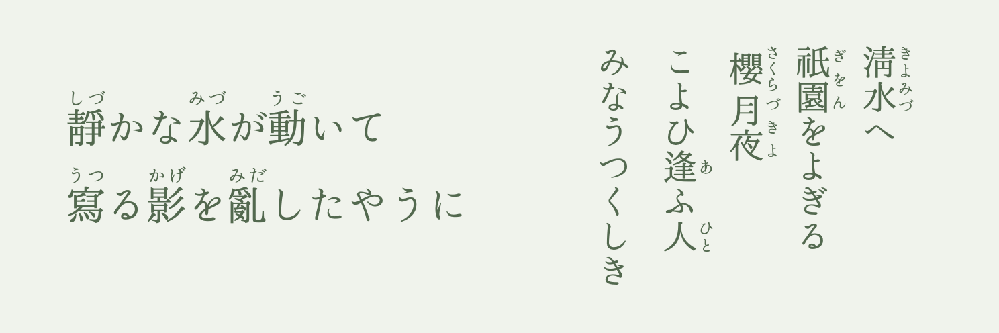

# Asebi Mincho / 馬酔木明朝

[日本語](README.md)

Asebi Mincho is a Japanese serif typeface for setting text in traditional kanji forms.

[Download the font](https://github.com/metasta/asebi-mincho/releases)

Both excerpts and their ruby readings use historical kana spelling. [Natsume Sōseki, Ten Nights of Dreams, First Night (horizontal)](https://www.aozora.gr.jp/cards/000148/files/799_14972.html) · [Yosano Akiko, Tangled Hair (vertical)](https://www.aozora.gr.jp/cards/000885/files/51307_47033.html)

## Installation

Extract the release ZIP and install `AsebiMincho2-Light.otf`. Choose **Asebi Mincho 2** or **馬酔木明朝 2** from your app’s font menu. The **2** in the menu name allows this edition to be installed alongside the previous one. The font comes in a Light weight.

### Web browsers

Chrome and Firefox let you select an installed font as the browser default. This applies where the page relies on browser defaults. Site-specific font choices may still apply. [Chrome settings](https://support.google.com/chrome/answer/96810?hl=en) · [Firefox settings](https://support.mozilla.org/en-US/kb/change-fonts-and-colors-websites-use)

Safari on macOS offers a user style sheet setting under Advanced. Its settings do not include a default font picker. Safari’s privacy protections can also limit access to installed fonts from web pages. [Safari settings](https://support.apple.com/en-ie/guide/safari/ibrw1075/mac) · [WebKit’s tracking prevention](https://webkit.org/tracking-prevention/)

## Changes from the previous edition

### Kanji selection

This edition takes most of its kanji glyphs directly from I.Ming Seiji v1.1. When adding kanji or changing glyphs, it follows the same selection criteria, which consider character origins and Japanese usage. [I.Ming Seiji v1.1](https://github.com/epistularum/kanji-restoration/releases/tag/v1.1) · [Selection criteria](https://github.com/epistularum/kanji-restoration#正字-criteria)

The previous edition selected traditional kanji forms using Kadokawa’s *Shinjigen* dictionary. In this edition, the small hook at the start of the downward-right stroke in 校 and 文 has been removed. [Previous edition](https://metasta.github.io/asebi/)

Version 2.000 covers 11,810 kanji in total, drawn from levels 1–4 of JIS X 0213, the two Unicode CJK Compatibility Ideographs blocks, and Aozora Bunko’s annotations for characters outside JIS X 0208.

### Contextual forms and variation sequences

辯, 辨, and 瓣 are distinct kanji that share the form 弁 in modern Japanese. When the OpenType `calt` feature is enabled, 雄弁, 弁別, and 花弁 are displayed as 雄辯, 辨別, and 花瓣, respectively.

If a line break separates the characters needed by a rule, some apps may skip that rule. As a result, even automatic wrapping due to changes in window width or text size can affect the displayed form.

To retain the forms 余 and 予 when used as first-person pronouns, enter `余󠄀` or `予󠄀` in an app that supports ideographic variation sequences (IVS). In each sequence, U+E0100 follows the kanji. Asebi Mincho provides this option for the 17 sequences listed in the reference table. [Contextual rules and IVS reference (Japanese)](docs/contextual-forms.md)

## Technical documentation

The following documents are in Japanese.

- [Kanji coverage and Aozora Bunko character notes](docs/coverage.md)
- [Kanji selection and glyph differences from I.Ming Seiji](docs/glyph-differences.md)
- [Contextual forms and ideographic variation sequences](docs/contextual-forms.md)
- [Known issues and workarounds](docs/known-issues.md)

## License and sources

Asebi Mincho is distributed under the IPA Font License Agreement v1.0. The release ZIP includes copyright notices for the source fonts, instructions for reverting to the original typefaces, and editable OpenType table data in TTX format. [License text](IPA_Font_License_Agreement_v1.0.txt)

Nishiki Mincho 1.111 is the main source for kana, punctuation, and Latin characters, with additional material from Sanban Mincho 1.001 and IPAmj Mincho 006.01. [Sanban Mincho](https://www.akenotsuki.com/eyeben/fonts/sammin.html) · [IPAmj Mincho](https://moji.or.jp/mojikiban/font/)

Nishiki Mincho 1.111 was distributed under its own license. The final release, Nishiki Mincho 3.000, was distributed under the SIL Open Font License 1.1. [Nishiki Mincho 3.000 license information](https://www.akenotsuki.com/eyeben/fonts/nishiki.html)

Questions and bug reports are welcome on GitHub. [Issues](https://github.com/metasta/asebi-mincho/issues)
