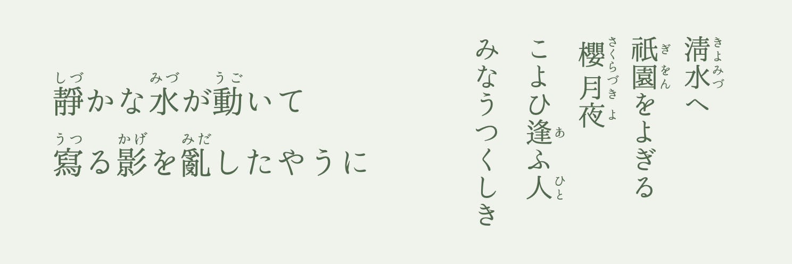

# 馬酔木明朝 / Asebi Mincho

[English](README.en.md)

馬酔木（あせび）明朝は、日本語を正字で組むための明朝体です。

[フォントをダウンロード](https://github.com/metasta/asebi-mincho/releases)

[夏目漱石『夢十夜』第一夜](https://www.aozora.gr.jp/cards/000148/files/799_14972.html)・[与謝野晶子『みだれ髪』](https://www.aozora.gr.jp/cards/000885/files/51307_47033.html)

## 利用方法

配布ZIPを展開し、`AsebiMincho2-Light.otf` をインストールします。ファミリー名は「馬酔木明朝 2」（日）または「Asebi Mincho 2」（英）、PostScript名は `AsebiMincho2-Light`、ウェイトはLightです。旧版と併存できます。

Webブラウザの既定フォントに馬酔木明朝を指定すると、サイト側が既定フォントに任せた箇所を馬酔木明朝で表示できます。macOS版Safariなど既定フォントを選ぶ設定がない一部のブラウザでは、ユーザースタイルシートを指定することで表示できる場合があります。

[Chromeの設定](https://support.google.com/chrome/answer/96810?hl=ja)・[Firefoxの設定](https://support.mozilla.org/ja/kb/change-fonts-and-colors-websites-use)・[Safariの詳細設定](https://support.apple.com/en-ie/guide/safari/ibrw1075/mac)・[WebKitのプライバシー保護](https://webkit.org/tracking-prevention/)

## 旧版からの変更点

### 収録範囲と字形の基準

JIS X 0213の第1〜第4水準、Unicodeの互換漢字、青空文庫の外字注記に由来する漢字を計11,810字収録します。

新版では、漢字に[一点明朝正字 v1.1](https://github.com/epistularum/kanji-restoration/releases/tag/v1.1)の字形を採用しました。字形の補完や変更には、[一点明朝正字の字形選定基準](https://github.com/epistularum/kanji-restoration#正字-criteria)を参照します。

この変更により、『角川 新字源』を基準とする「旧字明朝」であった[旧版](https://metasta.github.io/asebi/)に対し、新版は字の成り立ちに基づく「正字明朝」となり、いくつかの漢字で字形が変更されました。旧版で「文」や「校」にあった「ツメ（ヒゲ）」などの伝統的な装飾筆画も、新版では除かれた字形となりました。

### 複数の正字を持つ漢字への対応

#### 異体字シーケンスで字形を指定する機能

「餘」（あまり）と「余」（わたし、一人称）は、今の表記では同じ「余」と書く別の漢字です。新版では異体字シーケンス（IVS）の利用により、同じ「余」の字を通常の「餘」の字形ではなく「余」の字形で表示できます。「`余󠄀`」（余 `U+4F59`＋異体字セレクタ `U+E0100`）と入力することで、IVSに対応する環境で「餘」ではなく「余」の字形で表示します。「余」のほか、「予」「灯」「芸」などを含む計17字が対象です。

#### 文脈に適した字形を自動選択する機能

「辯」「辨」「瓣」は、今の表記では同じ「弁」と書く別の漢字です。新版ではOpenTypeの `calt` 機能により、同じ「弁」の字を文脈（前後の字）に応じて適した字形で表示し分けることができます。「雄弁」は通常「雄辯」と表示します。`calt` が有効な環境では、「弁別」「花弁」をそれぞれ「辨別」「花瓣」と表示します。「弁」のほか、「芸」「台」「欠」などを含む計10字が対象です。

`calt` 機能はフォント内の文脈辞書に登録された語彙についてのみ働きます。また、文脈の途中で改行されるなど表示が分割されると `calt` が適用されないことがあります。対象字を常に適した字形で表示し分けるには、明示的に「雄辯・辨別・花瓣」と入力し分けてください。

 [文脈規則とIVSの対応表](docs/contextual-forms.md)

## 技術資料

- [漢字の収録範囲と青空文庫の外字](docs/coverage.md)
- [漢字の選定基準と一点明朝正字との字形差](docs/glyph-differences.md)
- [文脈による字形選択と異体字シーケンス](docs/contextual-forms.md)
- [既知の不具合と対処法](docs/known-issues.md)

## 使用許諾と素材

馬酔木明朝はIPAフォントライセンスv1.0で配布します。配布ZIPには、各素材の著作権表示、原版へ戻す手順、再加工用のOpenTypeテーブル（TTX）が含まれます。 [ライセンス原文](IPA_Font_License_Agreement_v1.0.txt)

かな・約物・欧文の主な素材は錦明朝 1.111です。一部に三番明朝 1.001とIPAmj明朝 006.01も採用しました。 [三番明朝](https://www.akenotsuki.com/eyeben/fonts/sammin.html)・[IPAmj明朝](https://moji.or.jp/mojikiban/font/)

錦明朝 1.111には独自のライセンスが適用されます。最終版の錦明朝 3.000はSIL Open Font License 1.1で配布されました。 [錦明朝 3.000の配布条件](https://www.akenotsuki.com/eyeben/fonts/nishiki.html)

馬酔木明朝に関する質問や不具合の報告は、GitHub Issuesで受け付けます。 [Issues](https://github.com/metasta/asebi-mincho/issues)
