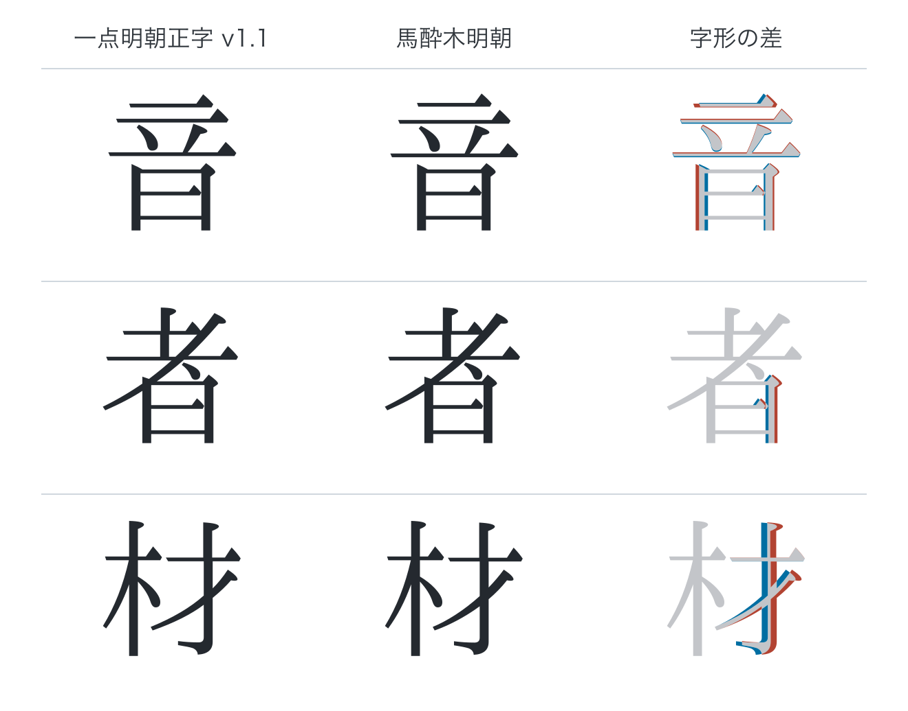

# 漢字の選定基準と一点明朝正字との字形差

馬酔木明朝は、一点明朝正字と同じ基準で漢字の字形を選びます。一点明朝正字に未収録の字と、収録済みでも元の照合結果を確認できない字については、字書や原典、用例から字の成り立ちと用法を確かめ、同じ基準で採用する字形を決めました。既存の字形で対応できない場合は、照合した形を新たに描きました。 [一点明朝正字の字形選定基準](https://github.com/epistularum/kanji-restoration#正字-criteria)

正字の基準を満たす字形でも、字を並べると一部の幅や位置が目立つことがあります。「音」の下の「日」など、気になる箇所は字の構成を保ったまま手作業で微調整しました。

## 同じ文字コードで字形が異なる字

馬酔木明朝のバージョン2.000と一点明朝正字 v1.1で、同じ文字コードに対応する通常の表示を比べると、53件で字形に差があります。比較の対象となる「輪郭」は、フォントが字を表示するとき、塗りつぶす部分の境界を表す線です。

| 理由 | 符号位置の数 |
| --- | ---: |
| 字の幅や配置の調整 | 14 |
| 字書などの照合による異体字の表示 | 28 |
| Unicodeで対応する互換漢字の表示 | 10 |
| 「弁」の通常の字形 | 1 |
| 合計 | 53 |

### 字の幅や配置を調整した字

調整した13字と、そのうち「者」と同じ形で表示する互換漢字「者」を掲載します。図では、馬酔木明朝の形にだけある部分を青、一点明朝正字の形にだけある部分を赤、共通する部分を灰色で示します。

| 入力字 | 符号位置 | 調整箇所 |
| --- | --- | --- |
| 億 | U+5104 | 意の下部にある日の幅と横画の端 |
| 意 | U+610F | 音の下部にある日の幅と横画の端 |
| 指 | U+6307 | 旨の下部にある日の幅と横画の端 |
| 暗 | U+6697 | 音の下部にある日の幅と横画の端 |
| 書 | U+66F8 | 下部にある日の幅と横画の端 |
| 材 | U+6750 | 右側の才を左寄りに配置 |
| 章 | U+7AE0 | 中央にある日の幅と横画の端 |
| 習 | U+7FD2 | 下部にある日の幅 |
| 者 | U+8005 | 下部にある日の右側と横画の端 |
| 鏡 | U+93E1 | 右側にある日の幅と横画の端 |
| 階 | U+968E | 下部にある日の幅と横画の端 |
| 音 | U+97F3 | 上部の横画と、下部にある日の幅と横画の端 |
| 香 | U+9999 | 下部にある日の幅と横画の端 |
| 者 | U+FA5B | 調整後の「者」（U+8005）と同じ形 |

### 照合に基づく異体字の表示

字書を照合し、異体字（同じ字を表す別の形）かを確認します。青空文庫などの本文も参照し、その箇所で表す字と意味を確かめます。表示を一つの形にまとめる場合は、字の成り立ちと字書の記載に基づき、字形を選びます。

現代日本語で意味や用法が分化した場合や、別義の現用字との混同が生じる場合は、表記の区別を保ちます。「着」は「著」の俗字に由来し、後に「着用」「到着」などの表記に定着しました。一点明朝正字でも、両字の字形は別です。 [一点明朝正字 v1.1 の字形選定基準](https://github.com/epistularum/kanji-restoration/blob/v1.1/README.md#正字-criteria)・[『角川新字源』の「着」の成り立ち](https://www.kanjipedia.jp/kanji/0004715800)

「䨇」の場合、『漢語大字典』は「雙」と同じ字とし、青空文庫『伊沢蘭軒』の「十䨇」も「十雙」の意味です。字形については、『教育部異體字字典』が「雙」を見出しとし、「隻」を二つ並べた「䨇」をその俗体と記します。この照合をもとに、二つの「隹」の下に「又」がある「雙」を正字として選び、一点明朝正字の字形を採用しました。「䨇」を入力したときの文字コードはそのままです。 [教育部異體字字典](https://dict.variants.moe.edu.tw/dictView.jsp?ID=49110&la=1)・[青空文庫『伊沢蘭軒』](https://www.aozora.gr.jp/cards/000129/card2084.html)

表の「字形の参照先」は、一点明朝正字のどの文字の字形を採用したかを示します。

| 入力字 | 符号位置 | 字形の参照先 | 照合の根拠 |
| --- | --- | --- | --- |
| 㑃 | U+3443 | 拗 | 『教育部異體字字典』と『漢語大字典』が拗の異体として収録。青空文庫の「すねる」の用例にも合致。 [教育部異體字字典](https://dict.variants.moe.edu.tw/dictView.jsp?ID=17035&la=1) |
| 㠝 | U+381D | 巑 | 『正字通』が巑の俗字と記載。青空文庫では山の高さを表す。 [青空文庫の用例](https://www.aozora.gr.jp/cards/000879/card4628.html) |
| 㢧 | U+38A7 | 卷 | 『康熙字典』が卷との関係を記載。青空文庫では『説郛』の巻数を示す。 [康熙字典](https://ctext.org/kangxi-zidian/57/0/zh) |
| 㹅 | U+3E45 | 總 | 『康熙字典』が緫の変形と説明し、『教育部異體字字典』が總の異体として収録。 [教育部異體字字典](https://dict.variants.moe.edu.tw/dictView.jsp?ID=-33811) |
| 䇿 | U+41FF | 策 | 『洪武正韻』が策の俗字とする。『說文解字』が策の一部とする朿を含む形を採用。 [洪武正韻](https://ctext.org/wiki.pl?chapter=901802&if=gb)・[說文解字](https://ctext.org/shuo-wen-jie-zi/zhu-bu/zh) |
| 䨇 | U+4A07 | 雙 | 『教育部異體字字典』と『漢語大字典』が雙の異体として収録。 [教育部異體字字典](https://dict.variants.moe.edu.tw/dictView.jsp?ID=49110&la=1) |
| 墎 | U+588E | 郭 | 『漢語大字典』508頁では城郭の意味で郭と同字。青空文庫の用例も同じ意味。 [青空文庫の用例](https://www.aozora.gr.jp/cards/001344/card54856.html) |
| 橰 | U+6A70 | 槔 | 『教育部異體字字典』が汲水具を表す槔の俗字として収録。 [教育部異體字字典](https://dict.variants.moe.edu.tw/dictView.jsp?ID=60633&q=1) |
| 湼 | U+6E7C | 涅 | 『教育部異體字字典』と『漢語大字典』が涅の異体として収録。青空文庫では「涅湼」にニルバナの振り仮名。 [青空文庫の用例](https://www.aozora.gr.jp/cards/001666/card54421.html) |
| 溆 | U+6E86 | 漵 | 『教育部異體字字典』が水辺を表す漵の異体として収録。 [教育部異體字字典](https://dict.variants.moe.edu.tw/dictView.jsp?ID=62265) |
| 蘝 | U+861D | 蘞 | 『漢語大字典』3553頁所引の『正字通』が欠を含む形を俗字とするため、攵を含む蘞を採用。 [青空文庫の用例](https://www.aozora.gr.jp/cards/000106/card52354.html) |
| 驆 | U+9A46 | 蹕 | 『教育部異體字字典』が蹕と同義と記載。「駐驆」「警驆」の用例も同じ意味。 [教育部異體字字典](https://dict.variants.moe.edu.tw/dictView.jsp?educode=B05843) |
| 鷼 | U+9DFC | 鷳 | 『教育部異體字字典』が鷳の異体として収録。シロキジの意味で、発音を示す部分に閒を含む形を採用。 [教育部異體字字典](https://dict.variants.moe.edu.tw/dictView.jsp?ID=112835&la=0) |
| 𡘞 | U+2161E | 畚 | 『漢語大字典』421頁では畚と同字。青空文庫では土などを運ぶ籠を指す。 [青空文庫の用例](https://www.aozora.gr.jp/cards/000929/card47001.html) |
| 𡻋 | U+21ECB | 窟 | 『教育部異體字字典』と『漢語大字典』が窟の異体として収録。青空文庫の「月𡻋」は月のすみかの意味。 [青空文庫の用例](https://www.aozora.gr.jp/cards/001344/card49809.html) |
| 𤔩 | U+24529 | 攫 | 『篇海』が攫と同字とする。青空文庫ではつかみ取る意味。 [青空文庫の用例](https://www.aozora.gr.jp/cards/000981/card3646.html) |
| 𤗉 | U+245C9 | 窗 | 『教育部異體字字典』と『漢語大字典』が窗の異体として収録。青空文庫の「𤗉間」は窓辺を指す。 [青空文庫の用例](https://www.aozora.gr.jp/cards/000129/card2084.html) |
| 𤶛 | U+24D9B | 悒 | 『漢語大字典』2863頁所引の『正字通』が本来の表記を悒とする。青空文庫の漢詩では心配の意味。 [青空文庫の用例](https://www.aozora.gr.jp/cards/001341/card58169.html) |
| 𤺨 | U+24EA8 | 瘡 | 『教育部異體字字典』が、発音を示す部分に創を含む瘡の異体と記載。 [教育部異體字字典](https://dict.variants.moe.edu.tw/dictView.jsp?ID=-29001&la=0) |
| 𨀥 | U+28025 | 趑 | 『漢語大字典』3950頁が「𨀥跙」を「趑趄」と同じ意味とする。『康熙字典』にも両表記がある。 [康熙字典](https://ctext.org/kangxi-zidian/156/5/zh) |
| 𨜟 | U+2871F | 鄭 | 青空文庫の『現代訳論語』と『論語』憲問篇の同じ箇所に登場する国名。発音を示す部分に奠を含む鄭を採用。 [現代訳論語](https://www.aozora.gr.jp/cards/001097/files/43785_58836.html)・[論語](https://ctext.org/analects/xian-wen/zh) |
| 𨶑 | U+28D91 | 闃 | 『教育部異體字字典』と『漢語大字典』が闃の異体として収録。静寂を表す用例に合致。 [教育部異體字字典](https://dict.variants.moe.edu.tw/dictView.jsp?ID=74421) |
| 𩳦 | U+29CE6 | 魑 | 『漢語大字典』4723頁が魑と同字とし、『龍龕手鑑』の俗字の記載を引く。 [青空文庫の用例](https://www.aozora.gr.jp/cards/000050/card43466.html) |
| 𪉩 | U+2A269 | 鹽 | 『教育部異體字字典』が鹽の画を省いた俗体として収録。 [教育部異體字字典](https://dict.variants.moe.edu.tw/dictView.jsp?ID=52855) |
| 𫝂 | U+2B742 | 所 | 『漢語大字典』21頁が所と同字と記載。青空文庫の漢文調の文でも所に当たる。 [青空文庫の用例](https://www.aozora.gr.jp/cards/001398/card53028.html) |
| 𫝹 | U+2B779 | 念 | 『教育部異體字字典』が念の異体として収録。原本『失念術講義』でも忘却を指す箇所に登場する。 [原本](https://dl.ndl.go.jp/pid/759659) |
| 𬏣 | U+2C3E3 | 疝 | 『和製漢字の辞典』が古文書を引き疝の異体とする。『大岡政談』の「𬏣癪」も疝癪の意味。 [和製漢字の辞典](https://www.ksbookshelf2.sakura.ne.jp/nozomu-oohara/WaseikanjiJiten2/WaseikanjiJiten2_5a.html) |
| 𭽸 | U+2DF78 | 鼕 | 『教育部異體字字典』が鼕の異体として収録。青空文庫では太鼓の音を表す。 [青空文庫の用例](https://www.aozora.gr.jp/cards/000008/card47357.html) |

### Unicodeで対応する互換漢字

Unicodeでは、「卵」（U+F91C）と「卵」（U+5375）など、別の文字コードで同じ文字を表す組があります。この関係を正準等価と呼びます。馬酔木明朝に両方の文字コードがある場合は、どちらも同じ字形で表示します。次の表は、その結果、一点明朝正字と字形が異なる10件です。「者」は幅を調整した「者」と同じ形なので、調整の表に載せました。 [UnicodeのCJK互換漢字の説明](https://www.unicode.org/versions/Unicode17.0.0/core-spec/chapter-18/)

| 入力字 | 符号位置 | 共用先 | 共用先の符号位置 |
| --- | --- | --- | --- |
| 卵 | U+F91C | 卵 | U+5375 |
| 立 | U+F9F7 | 立 | U+7ACB |
| 屮 | U+FA3C | 屮 | U+5C6E |
| 艹 | U+FA5D | 艹 | U+8279 |
| 練 | U+FAB0 | 練 | U+7DF4 |
| 乁 | U+2F802 | 乁 | U+4E41 |
| 屮 | U+2F878 | 屮 | U+5C6E |
| 廾 | U+2F890 | 廾 | U+5EFE |
| 舁 | U+2F893 | 舁 | U+8201 |
| 甾 | U+2F936 | 甾 | U+753E |

一点明朝正字に互換漢字の符号位置がない場合は、同フォントの正準対応先の字形と比較できます。この比較で差がある2.000の61件は、[互換漢字の採用字形と根拠](compatibility-glyph-differences.md)に掲載します。

### 「弁」の通常の字形

馬酔木明朝で「弁」（U+5F01）を単独で入力すると、通常は「辯」と表示します。「弁別」や「花弁」などの語での表示や、「弁」そのものの形を指定する方法は、対応表を参照してください。 [文脈による字形選択と異体字シーケンス](contextual-forms.md)

## 比較の範囲と方法

バージョン2.000の収録漢字11,810字のうち、一点明朝正字 v1.1にも同じ文字コードがある10,983件について、文字と字形を対応させるフォント内の表（`cmap`）から比較対象を選びました。二次曲線を三次曲線に変換し、1 emを1,000単位とする座標に換算して、丸めの差を0.02単位まで許容しました。 [一点明朝正字 v1.1](https://github.com/epistularum/kanji-restoration/releases/tag/v1.1)

一点明朝正字 v1.1に同じ文字コードがない827件は、検証を経て、既存字形の利用または作字で補完しました。そのうち「𪮮」（U+2ABAE）は「撠」、「𣟗」（U+237D7）は「㰘」と同じ形で表示します。各字の来歴と新たに描いた字形のデータは、配布ZIPの `編集資料/漢字の割り当て.json` と `編集資料/作字/` にあります。 [漢字の収録範囲](coverage.md)

## 次版で確定した字形

次版の開発で確定した字形のうち、一点明朝正字の同じ符号位置、または正準対応先にある字形と異なるものを掲載します。表に正準対応先を示した組は、入力字と正準対応先を収録し、同じ既定字形で表示します。「採用字形」の字は、輪郭を参照した先を示します。 [一点明朝正字 v1.1 の字形選定基準](https://github.com/epistularum/kanji-restoration/blob/v1.1/README.md#正字-criteria)・[Unicode正規化仕様](https://www.unicode.org/reports/tr15/#Respecting_Canonical_Equivalence)

| 入力字 | 正準対応先 | 採用字形 | 根拠 |
| --- | --- | --- | --- |
| 䙜（`U+465C`） | — | 𥛝 | 『漢語大字典』3313頁は衣偏の形を訛字とし、『玉篇』の示偏の形を挙げます。『十二支考』の神名「泰䙜」も『山海經』の「泰𥛝」に当たります。 [漢語大字典](https://ivantsoi.myds.me/web/hydzd/orgpage.html?page=3313)・[十二支考](https://www.aozora.gr.jp/cards/000093/files/526_28258.html) |
| 䞇（`U+4787`） | — | 贄 | 『漢語大詞典』は䞇を贄と同字とし、宋刊本『資治通鑑』には同一人物の「陸䞇」「陸贄」が見えます。 [漢語大詞典と用例](https://www.shidianguji.com/character/%E4%9E%87) |
| 峀（`U+2F879`） | 峀（`U+5CC0`） | 岫 | 台湾原字の山＋由は岫の異体です。山＋田の形は別字の邦の古字に当たります。部品の配置差を本文用の形に統一する基準を適用し、推薦形體表の山偏＋由を採用しました。 [字源分離の資料](https://www.unicode.org/wg2/docs/n5259-IRGN2676Disunify5CC0.pdf)・[推薦形體表28頁](https://github.com/ichitenfont/inheritedglyphs/blob/master/table_of_recom_inherited_glyphs-1.04.pdf#page=29) |
| 𢆃（`U+2F889`） | 𢆃（`U+22183`） | 𢅼 | 『正字通』は𢆃を𢅼の俗字とします。『說文解字』が示す巾と声符の夒から成る𢅼を採用しました。 [漢語大字典871頁](https://ivantsoi.myds.me/web/hydzd/orgpage.html?page=871)・[說文解字・巾部](https://ctext.org/shuo-wen-jie-zi/jin-bu1/zh) |
| 𢌱（`U+2F891`）・𢌱（`U+2F892`） | 𢌱（`U+22331`） | 與 | 『異體字字典』によると、𢌱は與の古文の楷書形です。一点明朝正字が回の古字「囘」に「回」の形を割り当てる例に基づき、與の字形を共用します。 [異體字字典の研訂](https://dict.variants.moe.edu.tw/dictView.jsp?ID=36903)・[一点明朝正字の「囘」の選定](https://github.com/epistularum/kanji-restoration/blob/v1.1/seiji.tsv#L3328) |
| 㤜（`U+2F8A2`） | 㤜（`U+391C`） | 怴 | 『康熙字典』は㤜と怴を別項とします。『漢語大字典』は㤜を怴の訛字とし、同書所引の阮元校勘記は『公羊傳』の㤜を怴と校訂して、声符を戉と明記します。この校訂に基づき、忄＋戉を採用しました。 [康熙字典・怴](https://zh.wikisource.org/wiki/康熙字典/心部/五畫)・[漢語大字典2457頁](https://ivantsoi.myds.me/web/hydzd/orgpage.html?page=2457)・[阮元校勘記](https://www.donglishuzhai.net/chapter/10702.html) |
| 㩬（`U+2F8C7`） | 㩬（`U+3A6C`） | 𢹍 | 『正字通』は打つ義の𢹍に対し、㩬を訛字とします。一点明朝正字の戱・戲の選定と同じく、右側は虍の下に豆を置く戲です。 [康熙字典・㩬](https://ctext.org/kangxi-zidian/64/16/zh)・[一点明朝正字の選定表](https://github.com/epistularum/kanji-restoration/blob/aa3004083e6304854425fe971ec6f9f43a03f9c1/seiji.tsv#L13201) |
| 𣲼（`U+2F8FB`） | 𣲼（`U+23CBC`） | 厬 | 『集韻』は脇から出る泉の義で𣲼を厬の異体とします。『說文解字』の厂と声符の晷を含む厬を採用しました。 [異體字字典](https://dict.variants.moe.edu.tw/dictView.jsp?ID=55008) |
| 𣽞（`U+2F910`） | 𣽞（`U+23F5E`） | 厬 | 『集韻』は泉の義で𣽞を厬の異体とし、『正字通』は俗字とします。『說文解字』の厂と声符の晷を含む厬を採用しました。 [異體字字典](https://dict.variants.moe.edu.tw/dictView.jsp?ID=55013) |
| 𥐝（`U+2F94D`） | 𥐝（`U+2541D`） | 𥕐 | 『廣韻』の都歷切は、𥐝を「𥕐磓」の𥕐と同字とします。 [廣韻・都歷切](https://ytenx.org/kyonh/sieux/3676/)・[漢語大字典2587頁](https://ivantsoi.myds.me/web/hydzd/orgpage.html?page=2587) |
| 𦾱（`U+2F9B0`） | 𦾱（`U+26FB1`） | 摷 | 『正字通』は取る義の𦾱に対し、手部の摷を本来の形とします。『說文解字』の手と声符の巢を含む摷を採用しました。 [異體字字典](https://dict.variants.moe.edu.tw/dictView.jsp?ID=101105)・[說文解字注・摷](https://kanji-database.sourceforge.net/dict/swjz/v23.html) |
| 𠠄（`U+2F9D9`） | 𠠄（`U+20804`） | 㨄 | 『集韻』の直紹切は、刺す義で𠠄を㨄と同字とします。『周禮』注所引の『詩』にも手偏＋周の表記があります。 [康熙字典・𠠄](https://ctext.org/kangxi-zidian/18/14/zh)・[周禮正義・醢人](https://wk.100ke.info/zh-hant/周禮正義/74) |
| 𨜮（`U+2F9E5`） | 𨜮（`U+2872E`） | 作字 | 『異體字字典』は同じ形を卿と鄉の双方の異体に挙げます。𨜮の構成を保ち、最上画を檢校表の横画にするため、卿の左端全体を移しました。 [卿の異体欄](https://dict.variants.moe.edu.tw/dictView.jsp?ID=4968)・[鄉の異体欄](https://dict.variants.moe.edu.tw/dictView.jsp?ID=46476)・[檢校表100頁](https://github.com/ichitenfont/inheritedglyphs/blob/master/component_of_recom_inherited_glyphs-1.37.pdf#page=101) |
| 䦕（`U+2F9EF`） | 䦕（`U+4995`） | 閛 | 『漢語大字典』は門が閉まる音を表す閛の異体に䦕を挙げます。檢校表の全字例に基づき、門の内側は左右に点を持つ平です。 [漢語大字典4376頁](https://ivantsoi.myds.me/web/hydzd/orgpage.html?page=4376)・[檢校表75頁](https://github.com/ichitenfont/inheritedglyphs/blob/master/component_of_recom_inherited_glyphs-1.37.pdf#page=76) |
